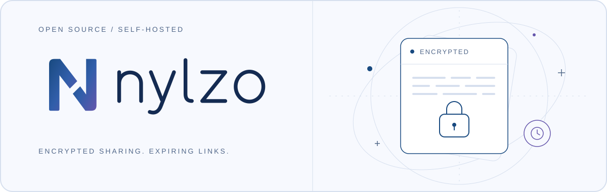

  <a href="https://nylzo.com">
    <picture>
      <source media="(prefers-color-scheme: dark)" srcset="assets/readme/cover-dark.svg">
      
    </picture>
  </a>

<h1 align="center">Share a secret. Set its expiry.</h1>

  Send a password, private note, or file through an encrypted link. 
  Nylzo encrypts it on your device. You choose when the link expires and how many times it opens.

  <a href="https://nylzo.com"><strong>Create a link</strong></a> ·
  <a href="https://github.com/misaon/nylzo/releases/latest">Download</a> ·
  <a href="https://github.com/misaon/nylzo/wiki">Documentation</a> ·
  <a href="https://github.com/misaon/nylzo/wiki/Self-hosting">Self-host</a>

  
  
  

## Share on your terms

- Text and files up to **5 MiB**, encrypted before upload. The decryption key stays in the link's URL fragment.
- Set an expiry and an open limit. Add a passphrase, cancel a message, or let the recipient delete it.
- Use the browser or CLI. Self-host the server and web client in **one Go binary** with SQLite and file storage.
- Check what you run: signed releases, build provenance, reproducible archives, and an instance transparency page.

## Pick your way in

| Use Nylzo              | Start here                                                                                                                         |
| ---------------------- | ---------------------------------------------------------------------------------------------------------------------------------- |
| **In your browser**    | [Create a link at nylzo.com](https://nylzo.com). No account required.                                                              |
| **From your terminal** | [Download the CLI](https://github.com/misaon/nylzo/releases/latest) for Windows, Linux, or macOS. x64 and ARM64 on every platform. |
| **On your own server** | [Deploy with Docker Compose and Caddy](https://github.com/misaon/nylzo/wiki/Self-hosting), or run the binary behind a TLS proxy.   |

[Verify your download](https://github.com/misaon/nylzo/wiki/Verify-a-release) before running it. The [Wiki](https://github.com/misaon/nylzo/wiki) covers setup, CLI examples, operations, and the protocol's security boundaries.

## Build with us

Bug reports, documentation, accessibility work, and code are welcome. Read the [contributing guide](CONTRIBUTING.md), pick an [issue](https://github.com/misaon/nylzo/issues), or bring an idea to [Discussions](https://github.com/misaon/nylzo/discussions).

Nylzo is early software and has not had an independent security audit. Read the [security model](https://github.com/misaon/nylzo/wiki/Security-model) before sharing sensitive data. Report vulnerabilities [privately](https://github.com/misaon/nylzo/security/advisories/new).

[MIT license](LICENSE) · [Name and logo](https://github.com/misaon/nylzo/wiki/Name-and-logo) · [Changelog](https://github.com/misaon/nylzo/releases)
