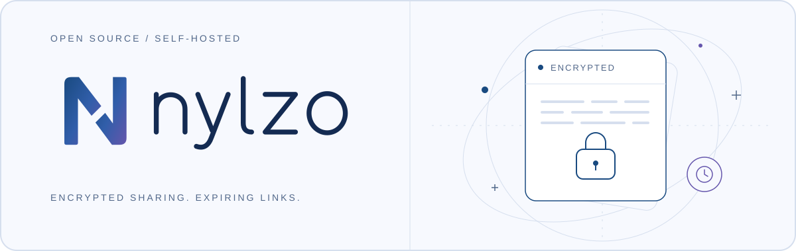

<p align="center">
  <a href="https://nylzo.com">
    <picture>
      <source media="(prefers-color-scheme: dark)" srcset="assets/readme/cover-dark.svg">
      
    </picture>
  </a>
</p>

<h1 align="center">Share a secret. Set its expiry.</h1>

<p align="center">
  Send a password, private note, or file through an encrypted link.<br>
  Nylzo encrypts it on your device. You choose when the link expires and how many times it opens.
</p>

<p align="center">
  <a href="https://nylzo.com"><strong>Create a link</strong></a> ·
  <a href="https://github.com/misaon/nylzo/releases/latest">Download</a> ·
  <a href="https://github.com/misaon/nylzo/wiki">Documentation</a> ·
  <a href="https://github.com/misaon/nylzo/wiki/Self-hosting">Self-host</a>
</p>

<p align="center">
  <a href="https://github.com/misaon/nylzo/releases/latest"></a>
  <a href="https://github.com/misaon/nylzo/actions/workflows/ci.yml"></a>
  <a href="https://app.codecov.io/gh/misaon/nylzo"></a>
  <a href="https://scorecard.dev/viewer/?uri=github.com/misaon/nylzo"></a>
  <a href="https://www.bestpractices.dev/projects/15969"></a>
</p>

## Features

- Text up to 100 KiB and files up to 5 MiB, encrypted on your device before upload.
- Links expire after at most 7 days and after the number of opens you set. Add a passphrase, cancel a link you sent, or let the recipient delete the message.
- One Go binary holds the `nylzo` CLI and the web client, and runs the server on Linux and macOS with SQLite and file storage.
- Signed releases with build provenance and reproducible archives. `nylzo verify-client` compares the web client an instance serves with the signed release.

## How it works

1. Your browser or the CLI generates a random secret and encrypts the message with AES-256-GCM.
2. Only the ciphertext goes to the server. The secret travels in the link after `#`, the part of a URL that browsers do not send to servers.
3. The server counts opens and enforces the expiry. When the hour in which a link expires ends, the server erases the key it needs to produce the link's decryption share, so a copy of the stored data stops opening too.
4. The recipient's browser or CLI decrypts the message locally.

The [protocol](https://github.com/misaon/nylzo/wiki/Protocol) defines the cryptography. The [security model](https://github.com/misaon/nylzo/wiki/Security-model) explains what Nylzo does not protect against, such as a server that sends you a modified web client.

## Get started

| Use Nylzo          | Start here                                                                                                                                                     |
| ------------------ | -------------------------------------------------------------------------------------------------------------------------------------------------------------- |
| In your browser    | [Create a link at nylzo.com](https://nylzo.com). No account required. Its limits and operator are on its [transparency page](https://nylzo.com/transparency). |
| From your terminal | [Download the CLI](https://github.com/misaon/nylzo/releases/latest) for Windows, Linux, or macOS, on x64 or ARM64.                                            |
| On your own server | [Deploy with Docker Compose and Caddy](https://github.com/misaon/nylzo/wiki/Self-hosting), or run the binary behind a TLS proxy.                               |

[Verify your download](https://github.com/misaon/nylzo/wiki/Verify-a-release) before you run it. Then create a link from a file and read it back:

```sh
nylzo create --server https://nylzo.com --ttl 1h --opens 1 < message.txt > link.txt
nylzo read --link-file link.txt --out received
```

The [CLI guide](https://github.com/misaon/nylzo/wiki/CLI) covers passphrases, attachments, and `nylzo web`, which runs the web client from the binary so the instance sends no code to your browser.

## Security

Nylzo is pre-1.0 software and has not had an independent security audit. Only the latest release receives security fixes. Read the [security model](https://github.com/misaon/nylzo/wiki/Security-model) before you share sensitive data, and report vulnerabilities [privately](https://github.com/misaon/nylzo/security/advisories/new) as [SECURITY.md](SECURITY.md) describes.

## Contributing

Read the [contributing guide](CONTRIBUTING.md), pick an [issue](https://github.com/misaon/nylzo/issues), or start a [discussion](https://github.com/misaon/nylzo/discussions). [SUPPORT.md](SUPPORT.md) says where to ask for help.

[MIT license](LICENSE) · [Name and logo](https://github.com/misaon/nylzo/wiki/Name-and-logo) · [Changelog](https://github.com/misaon/nylzo/releases)
